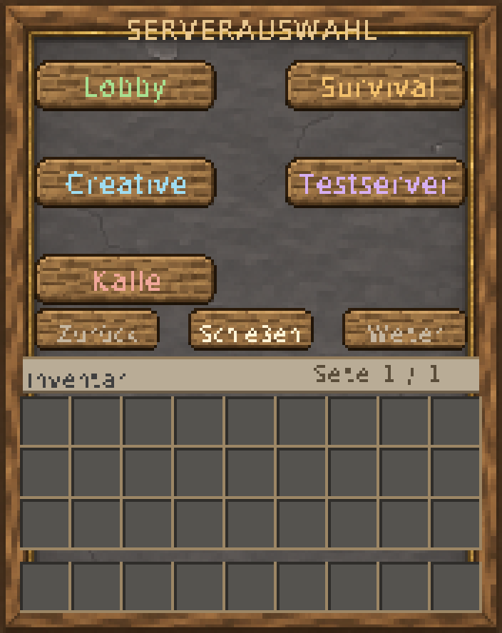

# ServerHub GUI 2.1.0

**Eine JAR für Paper und Velocity. Ein Pflichtpaket pro Netzwerkbeitritt.**

[ServerHub-2.1.0.jar herunterladen](https://github.com/etzewetze/serverhubgui/releases/download/v2.1.0/ServerHub-2.1.0.jar) · [Release und Komplettpaket](https://github.com/etzewetze/serverhubgui/releases/tag/v2.1.0)

Für **Minecraft Java / Paper 26.3**, **Velocity 4.2.0**, **Java 25**.



## Installation und Update

1. Proxy und Paper-Server beenden. Alte `ServerHub.jar`, `ServerHub-Paper-2.0.0.jar` bzw. `ServerHub-Velocity-2.0.0.jar` entfernen. Pro Prozess darf nur eine ServerHub-JAR installiert sein.
2. **Dieselbe `ServerHub-2.1.0.jar`** in den `plugins/`-Ordner des Velocity-Proxys und in `plugins/` jedes gewünschten Paper-Backends kopieren. Es bleibt eine gemeinsame Download-Datei; sie wird an beiden Stellen gebraucht. Die Plattform lädt automatisch ihren eigenen Einstiegspunkt.
3. Das Netzwerk vollständig neu starten. Modern Forwarding muss bereits funktionieren; Backends dürfen ausschließlich über den vertrauenswürdigen Proxy erreichbar sein.
4. In `plugins/ServerHubPaper/config.yml` auf den Backends die `target`-Namen an `[servers]` in `velocity.toml` anpassen. Mitgeliefert sind `lobby`, `survival`, `creative`, `test`, `kalle`.
5. Im Standardmodus wird das Pflichtpaket **direkt per HTTPS aus diesem GitHub-Release** geladen. Kein weiterer HTTP-Port und keine selbst einzutragende Paketadresse sind nötig. Die ZIP steckt auch in der JAR und wird auf dem Proxy unter `plugins/serverhub-velocity/serverhub-pack.zip` abgelegt.
6. In der Proxy-Konsole `/serverhubproxy packcheck` ausführen. Erwartet werden HTTP 200 und ein passender SHA-1. Danach mit einem Java-Client über die öffentliche Velocity-Adresse beitreten.

### Vorhandene 2.0-Konfiguration

Die alte Proxy-Konfiguration ohne `pack.mode` wird automatisch nach `config-v2.0-backup.properties` gesichert und auf `pack.mode=github` umgestellt. Angepasste Timeouts, Meldungen und der Paket-Dateiname bleiben erhalten; die frühere `pack.url`-/Port-Konfiguration liegt in der Sicherung. Dadurch wird eine alte, nicht erreichbare HTTP-Adresse nicht weiter benutzt. Eine ausdrücklich gesetzte neue Konfiguration mit `pack.mode` wird nicht überschrieben.

Die Paper-Konfiguration bleibt erhalten. Für eine Erstinstallation mit der ursprünglichen fremdgenerierten JAR den alten Ordner `plugins/ServerHubPaper` zuerst sichern und die neue Beispielkonfiguration verwenden.

## Paket nur einmal im Netzwerk

Der Proxy verwaltet eine Sitzung vom ersten Backend-Beitritt bis zum echten Trennen der Verbindung. **Ein internes Wechseln zwischen Lobby, Survival, Creative usw. erzeugt keine neue Sitzung und kein neues ServerHub-Paketangebot.** Paper fragt lediglich den bestehenden Ladezustand beim Proxy ab. Auch mehrere gleichzeitige Handshakes, ein Paper-Reload oder `/serverhubproxy reload` starten keinen weiteren Download.

Bei einem erneuten Netzwerkbeitritt wird das Paket wieder als erforderlich angeboten. Minecraft kann die vorhandene Cache-Kopie anhand des SHA-1 nutzen; es muss nicht zwingend erneut heruntergeladen werden. Ob ein Bestätigungsdialog erscheint, hängt auch von den gespeicherten Client-Einstellungen für Server-Ressourcenpakete ab.

Änderungen an Paketdatei oder Downloadadresse gelten für **neue Netzwerkbeitritte**. Bereits verbundene Spieler behalten ihre bestehende Paketsitzung. Zum Übernehmen einer Paketänderung neu verbinden. Beim Selbsthosting bleiben gerade verwendete Hash-Versionen verfügbar, damit ein laufender Download bei einem Reload nicht plötzlich andere ZIP-Bytes erhält.

Erst die erfolgreiche Anwendung des **genau zu dieser Sitzung gehörenden** Pakets schaltet das Menü frei. `ACCEPTED`/`DOWNLOADED` oder die Statusmeldung eines anderen Pakets reichen nicht. Ablehnung, Download-/Ladefehler, Verwerfen oder Timeout führen zum Kick. Das Standardlimit beträgt 120 Sekunden. Weitere Backend-Wechsel bleiben bis zur Paketladung gesperrt; die erste Backend-Verbindung ist für die Darstellung des Angebots nötig. ServerHub ist keine allgemeine Login-/Bewegungssperre.

**Andere Plugins:** ServerHub sendet sein Paket additiv und ruft kein globales `clearResourcePacks` auf. ExtraItems-Pakete bleiben erhalten. ExtraItems verwaltet aber eigene Paketangebote; diese werden durch ServerHub nicht abgeschaltet. Falls ExtraItems auf mehreren Backends jeweils einen Dialog auslöst, muss dessen eigene Auslieferung zusätzlich netzwerkweit eingerichtet werden.

## Download-Modi und Diagnose

Einstellungen auf dem Proxy: `plugins/serverhub-velocity/config.properties`.

| Modus | Verhalten |
|---|---|
| `pack.mode=github` | Standard: versionsgebundene öffentliche HTTPS-Release-ZIP. Die lokale ZIP muss unverändert dem in der JAR enthaltenen Paket entsprechen. |
| `pack.mode=self-host` | Proxy hostet die ZIP selbst. `self-host.public-host=auto` verwendet den Hostnamen aus der Beitrittsadresse, ähnlich dem Vorgehen von ExtraItems. |
| `pack.mode=external` | `pack.external-url` muss direkt dieselben ZIP-Bytes bereitstellen wie `pack.file`. Eigener HTTPS-Webspace ist möglich. |

Selbsthosting-Beispiel:

```properties
pack.mode=self-host
self-host.bind=0.0.0.0
self-host.port=8124
self-host.public-host=auto
self-host.scheme=http
self-host.advertised-port=8124
```

TCP-Port **8124 auf dem Velocity-Host** beim Hoster freigeben bzw. weiterleiten. Er ist vom Minecraft-Port und vom ExtraItems-Standardport 8123 getrennt. `auto` erkennt keinen beliebigen SRV-Zielhost, Tunnel oder NAT-Port automatisch. Dort eine feste öffentliche Domain/IP ohne Protokoll/Port und den tatsächlichen öffentlichen Port eintragen. IPv6 wird unterstützt. `https` ist für einen vorgeschalteten TLS-Reverse-Proxy vorgesehen; der eingebaute HTTP-Server selbst erzeugt keine TLS-Zertifikate. Bind, Port oder Aktivierung des HTTP-Servers ändern erfordert einen vollständigen Proxy-Neustart.

Bei `external` keine GitHub-Dateiansicht, Login-Seite oder Freigabeseite verwenden. Ein direkter Release-Asset-Link ist geeignet. Die ZIP beim Hochladen nicht neu verpacken, da sich dadurch der SHA-1 ändert. Eigene Texturen über `self-host` oder `external` ausliefern; der GitHub-Modus gehört zum unveränderten Release-Paket.

`/serverhubproxy packcheck` lädt die Antwort **vom Proxy aus**, folgt HTTP(S)-Weiterleitungen und vergleicht den vollständigen SHA-1. Er meldet u.a. HTTP 404, nicht erreichbare Hosts, HTML statt ZIP und abweichende Hashes. Das beweist die Erreichbarkeit vom Proxy, nicht von jedem Spieleranschluss. Bei `self-host.public-host=auto` den Befehl im Spiel ausführen oder den öffentlichen Host fest setzen. Ein `FAILED_DOWNLOAD` schreibt Status und verwendete Adresse in die Proxy-Konsole. Der Pflichtmodus wird bei Fehlern nicht stillschweigend deaktiviert.

## Menü und Bedienung

- **Shift + F:** schleichen und die Taste für den Handtausch drücken. Bei umbelegtem F gilt die neue Handtausch-Taste.
- `/extramenü`, `/extramenu`, `/extramen` oder `/serverhub` öffnen das Menü.
- Tabelle mit **zwei Spalten und drei Zeilen**, sechs Ziele pro Seite. `Zurück`/`Weiter` blättern; `Schließen` beendet das Menü.
- Steinfläche mit feinen Haarrissen, Holz-/Messingrahmen und den bereitgestellten Holzbuttons. Normale Truhen behalten ihr Aussehen.
- Schriftvarianten **8, 10 und 12**, pro Menü oder Eintrag einstellbar. Hexfarbe über `color: '#12AB34'`. Menü-Namen als Klartext; Tooltip zeigt den vollständigen Namen. Längere Beschriftungen werden passend gekürzt.
- Die Schriften unterstützen Latein und Latin-1 einschließlich äöüÄÖÜß. Chat/Hinweise unterstützen `&#RRGGBB` und klassische `&`-Farbcodes.
- Optionales Hotbar-Icon mit `hotbar-icon.enabled` und `slot: 0` bis `8`. Bis zur Paketladung Kompass, danach eigenes Menü-Icon; Rechtsklick öffnet das Menü. Das Icon ist gegen Ablegen/Verschieben geschützt.
- Vorhandene Gegenstände werden nur in einen freien normalen Inventarplatz umgelagert. Bei vollem Inventar wird kein Gegenstand überschrieben; Shift+F bleibt nutzbar. Ein erneuter Login oder Reload versucht die Icon-Platzierung erneut.
- Optionaler dezenter Hinweis mit Symbol in der Actionbar. Er ist im Vanilla-Client **zentriert oberhalb der Hotbar** und kann Actionbars anderer Plugins überlagern.
- Verbindungen erfolgen mit der nativen Velocity-API. Einträge brauchen den **echten Servernamen**, nicht nur einen Alias eines anderen Plugins. Bestehende fremde Alias-Befehle werden nicht geändert.

Die Oberfläche nutzt Inventar-Klickbereiche und Seiten. Freies Mausrad-Scrollen, ein frei rechts neben der Hotbar verankertes HUD und ein animierter Druckzustand für den ganzen Holzbutton sind nicht enthalten. Beim Überfahren kann der Vanilla-Client eine einzelne Inventarzelle markieren. Die Vorschau ist aus den echten Texturatlanten zusammengesetzt und kein Screenshot eines laufenden Clients.

## Ziele ergänzen und neu laden

Beispiel zusätzlich unter `servers` in der Paper-Konfiguration:

```yaml
  event:
    name: 'Event'
    target: event
    color: '#AADDFF'
    font-size: 10
    description:
      - 'Unser aktuelles Event'
    # permission: serverhub.event
```

Danach auf dem jeweiligen Backend `/extramenü reload` ausführen. Die Liste und offene ServerHub-Menüs werden aktualisiert; eine neue Textur-ZIP ist für weitere Server nicht nötig. Die Ziele müssen zusätzlich in Velocity registriert sein. Bei mehreren Backends die Konfiguration dort ebenfalls verteilen und neu laden. Ungültige Einstellungen werden abgewiesen, die vorherige Konfiguration bleibt aktiv.

Der Testserver ist standardmäßig mit `serverhub.test` geschützt und für normale Spieler ausgeblendet. Recht vergeben oder den `permission`-Eintrag entfernen, wenn ihn jeder sehen soll.

| Aktion | Befehl / Recht |
|---|---|
| Menü öffnen | `/extramenü`; `serverhub.use` (Standard alle) |
| Paper-Konfiguration laden | `/extramenü reload`; `serverhub.reload` (Standard OP) |
| Testserver sehen | `serverhub.test` (Standard OP) |
| Proxy-Konfiguration laden | `/serverhubproxy reload`; `serverhub.proxy.reload` oder Proxy-Konsole |
| Proxy-Status / Download prüfen | `/serverhubproxy status` bzw. `packcheck`; gleiches Proxy-Recht |
| Ziel am Proxy sperren | `serverhub.connect.<target>` ausdrücklich auf `false` setzen |

Paper- und Proxy-Berechtigungen sind getrennte Kontexte. Optionale Eintragsrechte werden auf Paper geprüft, die ausdrückliche Proxy-Sperre gilt zusätzlich. Bei fehlendem Proxy-Modul bleibt das Menü gesperrt; nach dem Handshake-Timeout wird getrennt. Eine parallele ServerHub-Paketpflicht durch `server.properties` oder eine alte JAR vermeiden.

## Build und Veröffentlichung

Vollständiger Quellcode und Grafikquellen liegen in diesem Repository. Java 25, Maven 3.9+ und Python 3 verwenden:

```sh
python3 tools/package_pack.py
mvn -B clean verify
python3 tools/prepare_release.py
```

Die eine fertige JAR liegt in `universal/target/ServerHub-2.1.0.jar`, veröffentlichbare Dateien in `dist/`. Die separaten Modul-JARs in `paper/target/` und `velocity/target/` sind interne Build-Zwischenergebnisse; installieren soll man die Universal-JAR.

Die eingecheckten PNGs werden beim normalen Build unverändert verpackt; dafür sind keine zusätzlichen Python-Pakete nötig. Zum Neugenerieren aus den hochauflösenden Grafikquellen `Pillow` installieren und `python3 tools/build_pack.py` ausführen; `tools/render_preview.py` braucht zusätzlich `PyYAML`.

GitHub Actions führt die Tests einschließlich der fertig gepackten Universal-JAR aus und erstellt auf `main` das in `release-version.txt` bezeichnete Release mit JAR, exakter Paket-ZIP, SHA-1, SHA-256 und Komplettpaket. Bereits veröffentlichte Release-Assets werden bei weiteren Commits nicht überschrieben. Für eine neue Version Maven-/Plugin-Version, `release-version.txt`, feste Release-URL und Release-Notizen gemeinsam aktualisieren.

## Validierung und Grenzen

Automatisierte Prüfungen umfassen Paketpflicht und exakte UUID, Timeout, parallele Initialisierung, Backend-Handshakes mit erhaltenem Ladezustand, Reload ohne neues Angebot, echten Wiederbeitritt, veraltete Disconnect-Ereignisse, Konfigurationsmigration, IPv6 und URL-Erzeugung, HTTP-Redirects, falsche Inhalte/Hashes, Plugin-Kanal-Spoofing, Menü-Seiten und Item-Erhalt.

Die fertig gepackte Universal-JAR wird zusätzlich in getrennten Klassenladern geprüft: Paper-Einstiegspunkt ohne Velocity-API und Velocity-Einstiegspunkt ohne Bukkit. Beide Deskriptoren und die identischen eingebetteten Paket-Bytes werden geprüft. Das ist **kein vollständiger Spieltest** mit verbundenem Minecraft-Client. Darstellung, vorhandene Fremdplugins und die konkrete Netzwerkumgebung müssen im Spiel geprüft werden. Bedrock/Geyser und andere Spielversionen sind nicht geprüft. Die Paketpflicht beruht auf den Client-Statusmeldungen und ist keine Integritätsprüfung gegen manipulierte Clients.

## Grafik und Referenzen

Die Holzbutton-Grafik stammt aus der bereitgestellten Vorlage; das Steinpanel wurde dafür generiert. Grafikquellen und Beschreibung liegen in `art-source/`; der Button wird als kompakte vorbereitete Spieltextur mitgeführt. Die Bitmap-Schriften wurden aus DejaVu Sans Condensed erzeugt; die Lizenz liegt bei.

Die Selbsthosting-Adressbildung wurde mit [ExtraItems PackService](https://github.com/etzewetze/extraitems/blob/main/Quellcode/src/main/java/de/extraitems/PackService.java) abgeglichen. ExtraItems wird nicht verändert.

- [Paper-Projektaufbau](https://docs.papermc.io/paper/dev/project-setup/)
- [Velocity Plugin Messaging](https://docs.papermc.io/velocity/dev/plugin-messaging/)
- [Velocity ResourcePackInfo](https://jd.papermc.io/velocity/4.2.0/com/velocitypowered/api/proxy/player/ResourcePackInfo.Builder.html)
